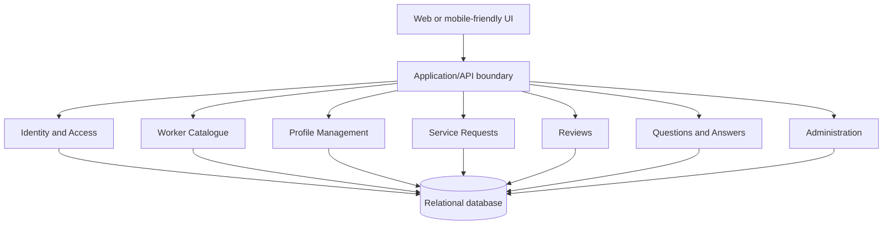

# ADR-001: Use a Modular Monolith for RentYourExpert

- **Status:** Proposed
- **Date:** 2026-10-27
- **Decision owners:** RentYourExpert product and engineering team

## Context

RentYourExpert connects customers with workers who provide expert services. The
system must support three roles:

- **Customers** can register and log in, manage their profile, browse and
  search workers by skills and location, view worker details and reviews,
  submit and delete requests, ask questions, read answers, and create, update,
  or delete their own reviews.
- **Workers** can register and log in, manage their profile, view requests
  addressed to them, accept or reject requests, and answer customer questions.
- **Administrators** can log in, inspect and manage customers, workers,
  requests, reviews, questions, and associated answers.

The primary entities are users, role-specific profiles, workers' skills and
locations, service requests, reviews, questions, and answers. The main
consistency relationships are that a request belongs to a customer and a
worker, a review is authored by a customer about a worker, and an answer
belongs to a worker's question.

The requirements emphasize a user-friendly interface, secure authentication and
authorization, search, profile management, worker reviews, and communication
through Q&A. They do not specify expected traffic, availability targets,
payment processing, notifications, file uploads, service-level objectives,
deployment environment, or team size. Those are important unanswered
questions.

The following are assumptions for this decision, not additional requirements:

1. The initial product is a single application with a small or moderately
   sized engineering team.
2. Requests, reviews, questions, and answers require ordinary transactional
   consistency and do not require independent deployment at launch.
3. Search can initially be served from the transactional database with
   suitable indexes; a dedicated search engine can be added if measurements
   justify it.
4. Registration and login apply to customers and workers, while administrator
   accounts are provisioned or managed through an administrative process.
5. Deleting a user or related content must follow an explicit retention policy,
   which remains to be decided.

## Decision

Adopt a **modular monolith**: deploy the web application and backend as one
unit, while dividing the code into business modules with explicit public
interfaces. Use one primary relational database initially, with ownership of
tables and write operations assigned to modules.

This approach provides the simplest reliable implementation for the stated
CRUD, search, moderation, and request workflows while preserving boundaries
that can later support extracting a module into a separately deployed service.

Authentication is implemented centrally by an Identity and Access module.
Authorization is enforced both at the application boundary and inside use
cases: customers may change only their own resources, workers may manage only
their own profiles and requests, and administrators receive explicitly
privileged management operations. Every sensitive mutation must derive the
acting identity from the authenticated session or token rather than trusting
client-supplied user IDs.

## High-level structure



The modules are:

1. **Identity and Access**
   - Registration, login, logout, session or token lifecycle, password
     security, role assignment, and authorization policies.
   - Publishes an authenticated principal and role/permission checks; other
     modules do not implement their own authentication.
2. **Profile Management**
   - Customer and worker profile data and worker-editable information.
   - Owns profile writes and exposes redacted profile views where needed.
3. **Worker Catalogue**
   - Worker listing, worker detail pages, and filtering by skill and location.
   - Reads worker profile data through a catalogue interface rather than
     directly reaching into another module's internals.
4. **Service Requests**
   - Customer request creation and deletion, customer request history, worker
     request views, and worker accept/reject decisions.
   - Owns request state transitions and validates customer/worker ownership.
5. **Reviews**
   - Customer review creation, update, and deletion; worker review display;
     administrator moderation and deletion.
6. **Questions and Answers**
   - Customer questions, worker answers, public worker Q&A display, and
     administrator removal of a question with its related answers.
7. **Administration**
   - Administrative views and commands for customer, worker, request, review,
     and Q&A management. It calls module application interfaces and does not
     modify other modules' tables directly.

The user interface may be server-rendered or a separate client consuming the
application API; that choice does not change the module boundaries. Communication
between modules is in-process method or application-service calls. Transactions
are used within a module and across closely related request/review/Q&A changes
when the business operation requires atomicity.

Direct access to another module's repositories, tables, or internal domain
objects is prohibited by package/module visibility rules, code review, and
architecture tests. Only documented commands, queries, and domain events are
public.

## Alternatives considered

### Alternative 1: Conventional layered application

Build one application with shared controller, service, repository, and model
layers. All features use the same database and common services.

```text
UI -> Controllers -> Shared services -> Shared repositories -> Relational DB
```

Authentication and role checks would be implemented in shared middleware and
service methods. Catalogue, requests, reviews, and Q&A would be feature areas
inside the shared service layer.

**Benefits**

- Lowest initial setup and deployment complexity.
- Straightforward transactions and local development.
- Suitable for a small team and modest traffic.

**Costs and risks**

- Shared models and repositories make it easy for features to bypass ownership
  boundaries.
- Authorization rules can become inconsistent across controllers and services.
- Tightly coupled code makes later independent scaling or extraction harder.

**Best fit:** a prototype, short-lived academic exercise, or system where
future growth and strict business boundaries are not priorities.

### Alternative 2: Separate frontend and backend API with a layered backend

Deploy a frontend independently from a backend API. The backend remains a
single layered application with a relational database, and the frontend calls
REST or GraphQL endpoints.

```text
Browser/mobile UI -> API gateway/backend -> Relational DB
                                      -> Optional search index
```

Authentication would use secure cookies or access/refresh tokens managed by the
backend. Authorization would be enforced in API middleware and use-case
services. Search could later be projected into a dedicated search index.

**Benefits**

- Clear client/server contract and support for multiple clients.
- Frontend and backend can be deployed and scaled independently.
- Easier to add a dedicated search service without changing the user
  interface.

**Costs and risks**

- More deployment, contract, and integration-test overhead than a single
  deployable application.
- API versioning and client compatibility become ongoing responsibilities.
- A layered backend can still develop the coupling problems of Alternative 1
  unless it uses explicit module boundaries.

**Best fit:** a product that already needs multiple clients or independent UI
and backend release cadence. It remains compatible with the selected modular
backend, but is not required by the current requirements.

### Alternative 3: Microservices by business capability

Deploy separate services for identity, profiles/catalogue, requests, reviews,
Q&A, and administration. Each service owns its data and communicates through
versioned APIs and, where useful, asynchronous events.

```text
Clients -> API gateway
             |-> Identity service -> Identity DB
             |-> Catalogue service -> Catalogue DB
             |-> Request service -> Request DB
             |-> Review service -> Review DB
             |-> Q&A service -> Q&A DB
             `-> Admin orchestration
```

Each service would enforce authorization for its own resources. Cross-service
workflows, such as creating a request that references a customer and worker,
would require APIs, replicated read models, or distributed workflow
coordination.

**Benefits**

- Independent deployment and scaling by capability.
- Strong runtime fault and ownership boundaries.
- Teams can evolve services independently when organizational scale requires
  it.

**Costs and risks**

- Highest operational complexity: service discovery, observability, deployment
  automation, secrets, retries, and compatibility management.
- Cross-entity consistency and administrative operations become distributed
  workflows.
- Too much infrastructure and failure surface for the stated initial scope.

**Best fit:** high and uneven scale, multiple autonomous teams, or clear
  requirements for independent availability and deployment.

## Consequences

### Benefits

- One deployment and one primary database keep the initial system inexpensive
  to operate.
- Module boundaries make authorization, data ownership, and business rules
  explicit.
- Request state changes, review ownership, and Q&A moderation can use ordinary
  database transactions.
- The architecture is easy to test at module and end-to-end levels.
- The application can add a separate frontend, search index, notifications, or
  extracted services without first rewriting all business logic.

### Costs and risks

- A monolith remains a shared runtime: a defect or resource problem can affect
  all capabilities.
- The team must actively enforce module boundaries; a modular monolith can
  deteriorate into a conventional layered monolith without architecture tests
  and review.
- Scaling is initially at application-unit granularity.
- A single database is a potential bottleneck and must be monitored.
- Dedicated search, messaging, notifications, payments, and file storage are
  not included until their requirements are established.

## Architectural rules

1. All external requests pass through the application/API boundary and are
   authenticated before protected use cases execute.
2. Each module owns its write operations and persistence abstractions.
3. Modules may use another module only through a documented public command,
   query, or event interface.
4. No module may import another module's repository or modify its tables
   directly.
5. Authorization is checked at the use-case boundary, not only in the UI.
6. Customer and worker mutations enforce resource ownership server-side.
7. Administrator operations are explicit privileged use cases and are audited
   where the retention policy requires it.
8. Request status transitions are validated by the Requests module; clients
   cannot set arbitrary status values.
9. Review and Q&A deletion behavior must preserve the chosen retention and
   moderation policy, including treatment of related answers.
10. Database indexes and pagination must support worker search and list pages;
    unbounded collection queries are not permitted.

## Data ownership

| Module | Owned data | Important consistency boundary |
|---|---|---|
| Identity and Access | Credentials, sessions/tokens, roles, account status | Authentication and role changes |
| Profile Management | Customer profiles, worker profiles, skills, locations | Profile update and visibility |
| Worker Catalogue | Catalogue read model or indexed catalogue projection, if introduced | Search result freshness |
| Service Requests | Requests, request participants, request status | Create/delete and accept/reject transitions |
| Reviews | Reviews and moderation state | Review author/worker ownership |
| Questions and Answers | Questions, answers, and moderation state | Removing a question and its related answers |
| Administration | No duplicated business ownership; admin audit records if required | Privileged command authorization |

The first implementation may store module-owned tables in one relational
database. Physical co-location does not remove logical ownership. If a
catalogue read model is introduced, it is derived from profile data and is not
the source of truth for worker profiles.

## Migration and evolution strategy

1. Establish module packages, public interfaces, role-aware authorization, and
   database ownership from the first implementation.
2. Start worker search with indexed relational queries and pagination.
3. Add an asynchronous catalogue projection or dedicated search engine only
   after measured search latency or relevance requirements justify it.
4. Add notifications or other asynchronous processing through an event
   publisher without making core request state transitions eventually
   consistent prematurely.
5. If one module needs independent scaling or deployment, replace its in-process
   interface with a versioned API or event contract, move its data behind that
   boundary, and retain an anti-corruption layer in the monolith during
   migration.
6. Extract the Requests module first only if its traffic, availability, or
   ownership needs materially differ; requests are a likely future boundary
   because their state transitions are business-critical.

## Validation criteria

The decision is successful when:

- All protected user stories pass automated authorization tests for customer,
  worker, and administrator roles, including denial of cross-user mutations.
- Module architecture tests prevent direct imports of another module's
  persistence internals.
- Request creation, deletion, acceptance, and rejection preserve valid state
  transitions under concurrent requests.
- Search by worker skill and location returns paginated results using indexed
  queries within the product's agreed latency target once that target is
  defined.
- Review update/delete and question-with-answers moderation behavior is covered
  by tests and follows the approved retention policy.
- A normal release can deploy and roll back the single application without
  manual changes to unrelated modules.
- Operational monitoring reports authentication failures, authorization
  denials, request errors, database health, and response latency.

## Revisit triggers

Reconsider this decision if any of the following occurs:

- Traffic or data volume requires independent scaling that cannot be achieved
  by scaling the monolith and database.
- A module needs materially different availability, deployment cadence, or
  runtime technology.
- Multiple teams need to release modules independently and coordination becomes
  a sustained delivery bottleneck.
- Cross-module failures or database contention cause the agreed availability or
  latency targets to be missed.
- Search relevance or query volume requires a dedicated search platform.
- Notifications, payments, file handling, or other omitted capabilities create
  sustained asynchronous or compliance requirements.
- A security or regulatory requirement demands stronger isolation of identity,
  administrative, or customer data.
